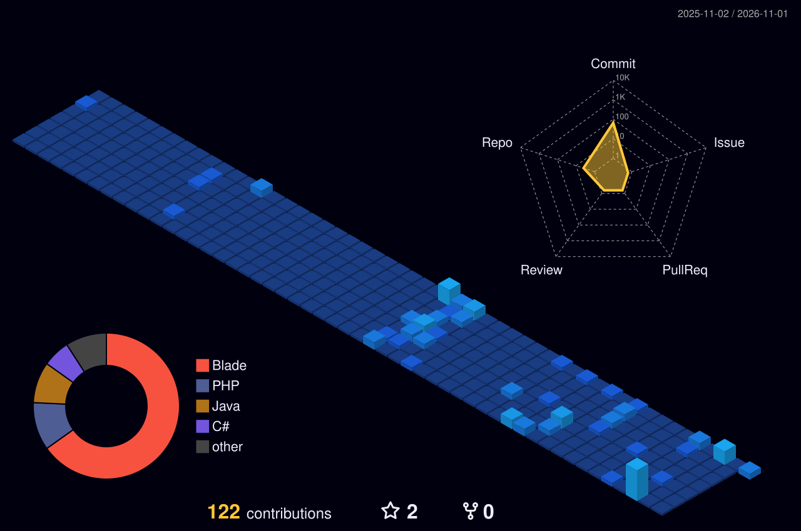

## ⚙️ Featured builds

| Build | What it is | Stack |
|:--|:--|:--|
| [**Repercussion**](https://github.com/ToriLiv/REPERCUSSION_GAME) | 2D top-down puzzle game about time loops: every failed attempt leaves an echo you can use to escape | `Unity` `C#` |
| [**Employee Shift Manager**](https://github.com/ToriLiv/employee-shift-manager) | REST API for employees and shifts with overlap validation, plus a Vue.js frontend | `Spring Boot` `SQL Server` `Vue` |
| [**Autonova System**](https://github.com/ToriLiv/autonova_system) | Desktop app for vehicle stock, clients and automated invoicing | `C#` `.NET` |
| [**Car Rental System**](https://github.com/ToriLiv/car_rental_system) | Rental management built around nine design patterns | `Java` |
| [**Virtual Library**](https://github.com/ToriLiv/app_web) | Library management web app with a responsive frontend | `Spring Boot` `Maven` `JavaScript` |
| [**Tasks API**](https://github.com/ToriLiv/api-restful) | Task and user REST API with JPA/Hibernate | `Spring Boot` `H2` |

## 🌃 My contribution city

*Every commit raises another building, rebuilt automatically every day.*

**The harder the problem, the more I want to understand it.** ⚙️

